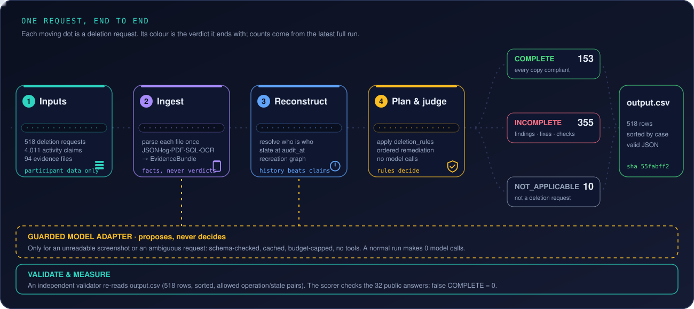
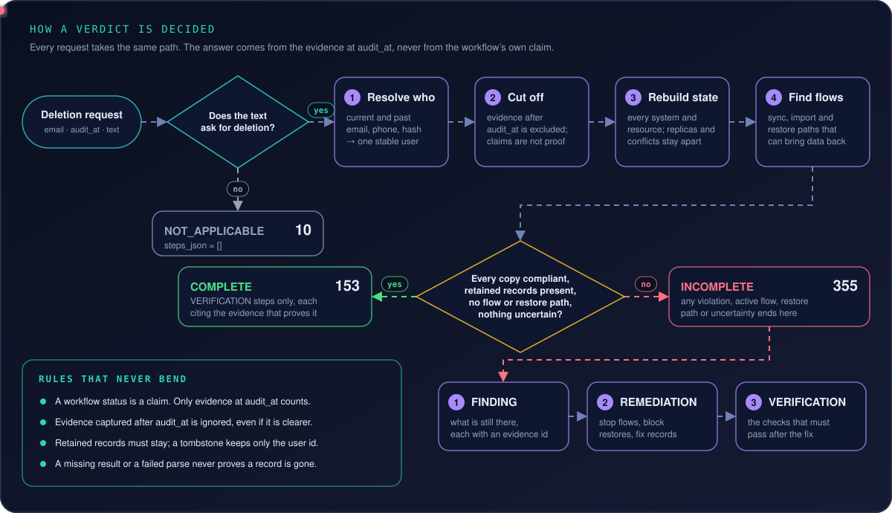
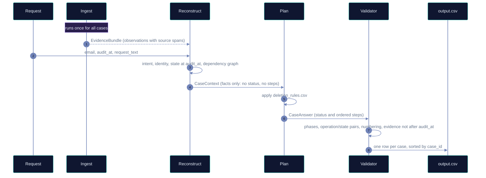
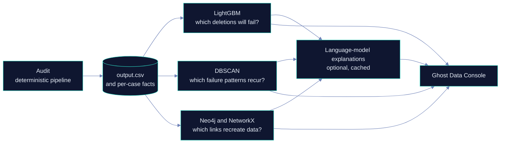

<div align="center">



<!-- AUTO:BADGES:START -->
     
<!-- AUTO:BADGES:END -->

**A deletion workflow can say “Complete” while personal data is still sitting in a replica, a log, a search index or a backup.**
GhostTrace reads the evidence, rebuilds what was true at the audit time, and tells you what is still there, in what order to fix it, and how to prove it is gone.

[The problem](#the-problem-in-20-seconds) ·
[How it works](#how-it-works) ·
[How a verdict is decided](#how-a-verdict-is-decided) ·
[What it found](#what-it-found) ·
[Console](#the-ghost-data-console) ·
[Quick start](#quick-start) ·
[Keeping this page current](#keeping-this-page-current)

</div>

---

## The problem in 20 seconds

Every request in this dataset asks a platform to erase one person. The workflow that handled it reports a status, and that status is only a **claim**. Data survives in places a “Complete” never touched: database replicas, support attachments, exports, search indexes, analytics, archives, backups. Sync and restore jobs can even **recreate** data that was already deleted.

GhostTrace is the agent for the HackerRank Orchestrate challenge *Ghost Data Still Exists* (October 2026). For each of the 518 requests it decides whether deletion was really requested, finds every copy, applies the supplied retention policy, and writes `output.csv` with a status and an ordered list of steps.



> The rule that shapes everything: **deterministic code decides** identity, state, policy, status and steps. An AI model may only *propose* a structured fact (a hard-to-read screenshot, an ambiguous request) through one guarded adapter. It never assigns a status or a step, and a normal run makes **0 model calls**.

## How it works



| # | Stage | What it does | Code |
|---|---|---|---|
| 1 | **Ingest** (once, for all cases) | Reads all evidence once: JSON, six log layouts, text, PDF, SQL snapshots in a deny-by-default SQLite sandbox, and screenshots via OCR. Every fact keeps its source span. A parse failure becomes an explicit issue, never “no data”. | [`code/slam/ingestion/`](code/slam/ingestion/) |
| 2 | **Reconstruct** (per request) | Does the text really ask for deletion? Which person is behind this email, phone or hash, now and in the past? What was true at `audit_at`, ignoring later evidence? Which flows and restores could bring the data back? | [`code/slam/reconstruction/`](code/slam/reconstruction/) |
| 3 | **Plan** (per request) | Applies [`deletion_rules.csv`](dataset/deletion_rules.csv) to every copy and orders the answer as `FINDING` → `REMEDIATION` → `VERIFICATION`. No model calls. | [`code/slam/planning/`](code/slam/planning/) |
| 4 | **Validate and measure** | An independent validator re-reads `output.csv`; a scorer compares against the public sample answers; reports are written for the submission. | [`code/slam/evaluation/`](code/slam/evaluation/) |
| ∞ | **Runtime guard** | One model adapter (fake by default, Groq or OpenAI opt-in), content-addressed cache, usage metering, hard budget ceilings. | [`code/slam/runtime/`](code/slam/runtime/) |

## How a verdict is decided



The same journey for one request, in time order:



## What it found







<!-- AUTO:NUMBERS:START -->
| Measure | Value |
|---|---|
| Deletion requests audited | 518 (failed: 0) |
| Verdicts | 355 INCOMPLETE · 153 COMPLETE · 10 NOT_APPLICABLE |
| Workflow said COMPLETE, evidence disagrees | 163 of 254 (64.2%) |
| Input size | 850 identities · 306 identity changes · 4,011 activity events · 94 evidence files · 15 policy rules |
| Status accuracy on the public samples | 90.6% (32 cases) |
| Step precision / recall / F1 | 74.4% / 66.3% / 70.1% |
| Field / sequence / exact-row accuracy | 77.1% / 34.4% / 34.4% |
| Failure-risk model (LightGBM, cross-validated) | accuracy 72.2% · AUC 0.778 — vs 55.7% for trusting the reported status and 69.9% for always guessing INCOMPLETE |
| Test functions (offline) | 487 |
<!-- AUTO:NUMBERS:END -->

### Failures cluster into a few repeatable patterns

DBSCAN groups the incomplete deletions by what they left behind. A handful of patterns explain most of them, which is where fixing the deletion workflow pays off first.



## The Ghost Data Console

An optional insight layer reads what the deterministic audit already decided. It never changes `output.csv`.



| Tab | Shows |
|---|---|
| Failure risk | LightGBM prediction of which deletions fail, against the “trust the reported status” baseline |
| Pattern discovery | DBSCAN clusters of failure patterns |
| System graph | Neo4j / NetworkX recreation paths, plus a what-if: delete a system and re-audit live |
| Case explorer | Per-case answer with a rule-based or model-written explanation |
| Error patterns | Activity forecast from the event stream |
| Retention conflicts | Data that is no longer required but still held |

Details, the exact prompt and the measured numbers are in [`docs/INSIGHT_LAYER.md`](docs/INSIGHT_LAYER.md).

## Quick start

You need Docker (the 11 screenshots are read with Tesseract OCR, which lives in the image). The participant data is already in [`dataset/`](dataset/).

```bash
git clone https://github.com/Ashish-AIML-systems/ghosttrace.git
cd ghosttrace
docker compose build

# 1. audit all 518 requests -> output.csv and results/*.json (offline, no key, no spend)
docker compose run --rm slam-dev python code/main.py --dataset dataset

# 2. also score the 32 public samples and write evaluation/usage reports
docker compose run --rm slam-dev python code/main.py --dataset dataset --evaluate

# 3. run the test suite, lint and types
docker compose run --rm slam-dev pytest -q
docker compose run --rm slam-dev ruff check code tests scripts

# 4. open the console at http://127.0.0.1:8765
scripts/run_console.sh        # Windows: scripts\run_console.cmd
```

Without Docker: `uv sync --frozen`, install Tesseract, then `python code/main.py --dataset dataset`.
Console options, optional real-model checks and the team workflow are in [`docs/RUNBOOK.md`](docs/RUNBOOK.md).

Secrets come only from environment variables or an uncommitted `.env` (see [`.env.example`](.env.example)). The default provider is `fake`, so nothing here can spend money unless you opt in.

## Repository map

| Path | What it is |
|---|---|
| [`code/`](code/) | The solution: ingestion, reconstruction, planning, evaluation, runtime, insight layer |
| [`dataset/`](dataset/) | The official participant data (never part of `code.zip`) |
| [`output.csv`](output.csv) | The 518 answers: `case_id,deletion_status,steps_json` |
| [`results/`](results/) | Deterministic run summaries that this README is built from |
| [`evaluation/`](evaluation/) | Evaluation report, usage report, side-by-side sample comparison |
| [`dashboard/`](dashboard/) | The six-tab console and its Vercel function |
| [`docs/`](docs/) | Plans, integration notes, [insight layer](docs/INSIGHT_LAYER.md), [runbook](docs/RUNBOOK.md) |
| [`scripts/`](scripts/) | Packaging, smoke test, delivery gate, console launchers, [README generator](scripts/build_readme.py) |
| [`tests/`](tests/) | Offline test suite |
| [`AGENTS.md`](AGENTS.md) | Rules for every coding agent, including the logging contract ([`log.txt`](log.txt)) |

## Honest limits

- Accuracy is measured on the **32 public sample answers only**. HackerRank publishes no answers for the 518 evaluation requests, so no hidden-set accuracy is claimed.
- The exact-row match on those samples is far lower than the status accuracy. The remaining gaps, with the evidence for each, are in [`docs/integration/RCA_ACCURACY.md`](docs/integration/RCA_ACCURACY.md).
- When the evidence is conflicting or uncertain, GhostTrace answers on the safe side (`INCOMPLETE`) and records why, instead of certifying a deletion on a guess.
- Screenshots are read with OCR first. A model is only a fallback and its output is cross-checked, never trusted blindly; see [`evaluation/evaluation_report.md`](evaluation/evaluation_report.md).

## Keeping this page current

Every number and chart above is generated, not typed. [`scripts/build_readme.py`](scripts/build_readme.py) reads `results/*.json` and `dataset/*.csv` and rewrites the animated SVGs in [`docs/img/`](docs/img/) plus the blocks between the `AUTO` markers in this file.

```bash
python scripts/build_readme.py           # refresh after a new run
python scripts/build_readme.py --check   # exit 1 if the README is stale
```

The [README refresh workflow](.github/workflows/readme-refresh.yml) runs the generator whenever results, evaluation files or the generator change on `main`, and commits the refreshed page. Edit the prose freely; do not edit between the `AUTO` markers or inside `docs/img/*.svg`.

<!-- AUTO:RUN_ID:START -->
<sub>Generated by <code>scripts/build_readme.py</code> from <code>results/</code> and <code>dataset/</code> (output.csv sha256 <code>55fabff2a919…</code>, 518 rows). Edit the text outside the AUTO markers; everything between them is rewritten.</sub>
<!-- AUTO:RUN_ID:END -->

## Credits and origin

GhostTrace was built as **SLAM** by Ashish (evidence ingestion), Manya (request intent, identity and temporal state), Satvika (policy, planning and export) and D Lalith Chandra (contracts, runtime, evaluation and integration) for HackerRank Orchestrate. This repository is a copy of the team repository [`Satvika0404/slam`](https://github.com/Satvika0404/slam) at `main` (commit `18d4b0d`), with the full history, a rewritten README and the README generator added. The Python package is still called `slam`.

Challenge page: <https://www.hackerrank.com/contests/hackerrank-orchestrate-october26/challenges/ghost-data-still-exists>
